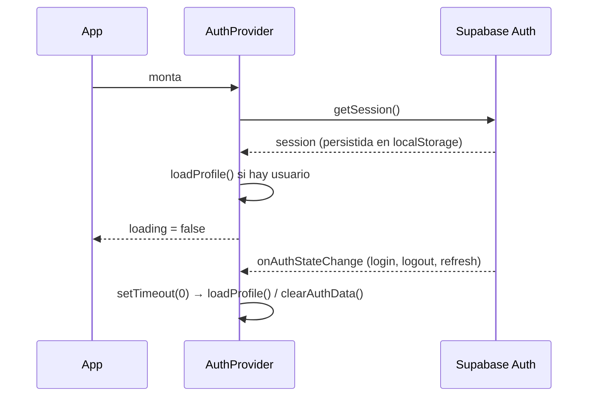
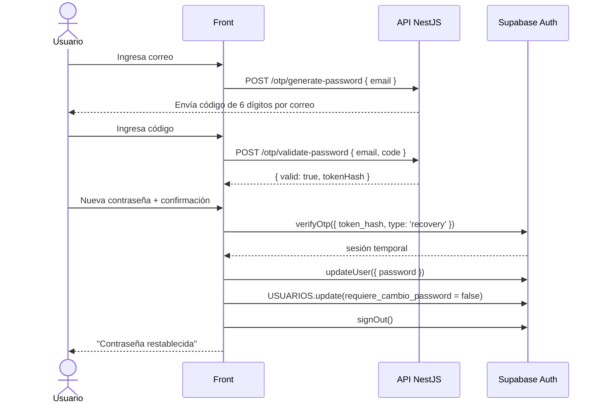

# 02 · Autenticación, sesión y roles

Módulo transversal: todas las pantallas dependen de él para saber quién es el usuario, qué roles tiene y si debe cambiar su contraseña.

## Archivos

| Archivo | Responsabilidad |
| --- | --- |
| [contexts/auth-context.ts](../src/contexts/auth-context.ts) | Define `AuthContext` y el tipo `AuthContextValue` (separado del provider para que Fast Refresh funcione) |
| [contexts/AuthContext.tsx](../src/contexts/AuthContext.tsx) | `AuthProvider`: sesión de Supabase, carga de perfil, persona y roles; acciones de login/logout/cambio de contraseña |
| [Funcionalidades/authentication/hooks/useAuthentication.ts](../src/Funcionalidades/authentication/hooks/useAuthentication.ts) | Hook `useAuth()` para consumir el contexto (lanza error si se usa fuera del provider) |
| [Funcionalidades/authentication/hooks/useRecuperarPassword.ts](../src/Funcionalidades/authentication/hooks/useRecuperarPassword.ts) | Máquina de estados del flujo "Olvidé mi contraseña" |
| [Funcionalidades/authentication/services/password-recovery.service.ts](../src/Funcionalidades/authentication/services/password-recovery.service.ts) | Llamadas a la API y a Supabase Auth para recuperar la contraseña |
| [components/Login/Login.tsx](../src/components/Login/Login.tsx) | Pantalla de inicio de sesión |
| [components/Login/OlvidePasswordModal.tsx](../src/components/Login/OlvidePasswordModal.tsx) | Modal de recuperación en 3 pasos |
| [components/Cuenta/CambiarPasswordModal.tsx](../src/components/Cuenta/CambiarPasswordModal.tsx) | Cambio de contraseña (voluntario u obligatorio) |
| [App.tsx](../src/App.tsx) | `ProtectedRoute` y `RoleRedirect` |
| [models/auth.ts](../src/models/auth.ts) | Tipos `UserProfile`, `UserRole`, `PersonData` y constantes de rol |

## Roles

Definidos como constantes en [models/auth.ts](../src/models/auth.ts). Deben coincidir con la columna `nombre` de la tabla `ROLES` (la comparación es *case-insensitive*).

| Constante | Valor | Qué puede hacer en el front |
| --- | --- | --- |
| `ROLE_TIENDAS` | `TIENDA` | Solo `/otp` (generar y redimir códigos) |
| `ROLE_CONTROL_INTERNO` | `CONTROL_INTERNO` | Historial, Mi cuenta, carga/exportación de usuarios y tablero de códigos |
| `ROLE_EMPLEADO` | `EMPLEADO` | Historial y Mi cuenta |
| `ROLE_SOCIO` | `SOCIO` | Historial y Mi cuenta |

## `AuthProvider`: qué expone

`useAuth()` devuelve:

| Campo | Tipo | Descripción |
| --- | --- | --- |
| `session` / `user` | `Session \| null` / `User \| null` | Sesión de Supabase Auth |
| `profile` | `UserProfile \| null` | Fila de `USUARIOS` del usuario autenticado |
| `person` | `PersonData \| null` | Fila de `PERSONAS` relacionada (`USUARIOS.id_persona`) |
| `roles` | `UserRole[]` | Roles con `USUARIOS_ROLES.estado = 'ACTIVO'` |
| `loading` | `boolean` | `true` mientras se resuelve la sesión inicial o un login en curso |
| `profileError` | `string \| null` | Error al cargar perfil o roles |
| `signIn({ email, password })` | `Promise<{ error }>` | `supabase.auth.signInWithPassword` (normaliza el correo a minúsculas) |
| `signOut()` | `Promise<{ error }>` | Cierra sesión y limpia el estado |
| `changePassword(newPassword)` | `Promise<{ error }>` | Actualiza la contraseña en Auth y pone `requiere_cambio_password = false` |
| `refreshProfile()` | `Promise<void>` | Recarga perfil y roles |
| `hasRole(role)` | `boolean` | Indica si el usuario tiene ese rol activo |

### Carga del perfil

`loadProfile(authUserId)` hace dos consultas directas a Supabase (sujetas a RLS):

1. `USUARIOS` filtrado por `auth_user_id`, con *embed* de `PERSONAS!usuarios_id_persona_fkey`.
2. `USUARIOS_ROLES` filtrado por `id_usuario` y `estado = 'ACTIVO'`, con *embed* de `ROLES!usuarios_roles_id_rol_fkey (id, nombre)`.

Si no existe la fila en `USUARIOS`, `profileError` queda en *"No se encontró el perfil del usuario."* y el usuario no tendrá roles (por tanto no podrá entrar a ninguna ruta con rol).

### Ciclo de vida de la sesión

La recarga del perfil dentro de `onAuthStateChange` se difiere con `setTimeout(0)` para no ejecutar consultas de Supabase dentro del callback de Auth (evita bloqueos conocidos del SDK).

## Inicio de sesión

[Login.tsx](../src/components/Login/Login.tsx):

1. Valida en cliente: correo obligatorio con formato válido y contraseña obligatoria.
2. Llama a `signIn`. Si falla, muestra el mensaje de Supabase en un toast.
3. Si tiene éxito, navega a `/login-confirmado`.
4. `RoleRedirect` espera a que terminen de cargar los roles y redirige:
   - rol `TIENDA` → `/otp`
   - cualquier otro → `/historial-codigos`

## Protección de rutas (`ProtectedRoute`)

Orden de evaluación en [App.tsx](../src/App.tsx):

1. `loading` → no renderiza nada.
2. Sin sesión → `/login`.
3. `requireRole` y el usuario no lo tiene → `/login`.
4. `blockRole` y el usuario lo tiene → `/login`.
5. `profile.requiere_cambio_password === true` → en lugar del contenido renderiza `CambiarPasswordModal` en modo `forced`.
6. Renderiza la ruta.

> La protección del front es solo de experiencia de usuario. La seguridad real la imponen las políticas RLS de Supabase, el guard de la API y las verificaciones dentro de las Edge Functions.

## Cambio de contraseña obligatorio

Los usuarios creados por carga masiva o por la sincronización con SharePoint reciben como contraseña inicial su **número de documento** y quedan con `USUARIOS.requiere_cambio_password = true`.

En modo `forced`, [CambiarPasswordModal.tsx](../src/components/Cuenta/CambiarPasswordModal.tsx):

- No se puede cerrar haciendo clic fuera ni con la ✕; el botón secundario es **Cerrar sesión**.
- Valida que la contraseña tenga al menos 8 caracteres, que no sea igual al número de documento y que coincida con la confirmación.
- Al guardar, `changePassword` llama a `supabase.auth.updateUser({ password })`, actualiza `USUARIOS.requiere_cambio_password = false` y `fecha_actualizacion`, y recarga el perfil. `ProtectedRoute` se vuelve a renderizar y muestra el contenido normal.

## Recuperación de contraseña ("Olvidé mi contraseña")

Flujo de 3 pasos en `OlvidePasswordModal` + `useRecuperarPassword`:

Reglas del hook:

| Paso | Validación en cliente | Comportamiento |
| --- | --- | --- |
| `email` | Obligatorio, formato de correo | Al enviar, inicia un contador de 30 s para habilitar "Reenviar código" |
| `code` | Exactamente 6 dígitos (se eliminan caracteres no numéricos) | Guarda el `tokenHash` que devuelve la API |
| `password` | Mínimo 8 caracteres y confirmación igual | Si falla el restablecimiento, el token (de un solo uso) se descarta y el flujo vuelve al paso `email` |

`restablecerPasswordRequest` siempre cierra la sesión temporal en un bloque `finally`, para que la persona inicie sesión con la contraseña nueva.

## Cierre de sesión

Disponible en la barra de cuenta de [AuthLayout](10-ui-y-estilos.md#authlayout) y en el modal de cambio obligatorio. Llama a `supabase.auth.signOut()`, limpia el estado y navega a `/login`.
