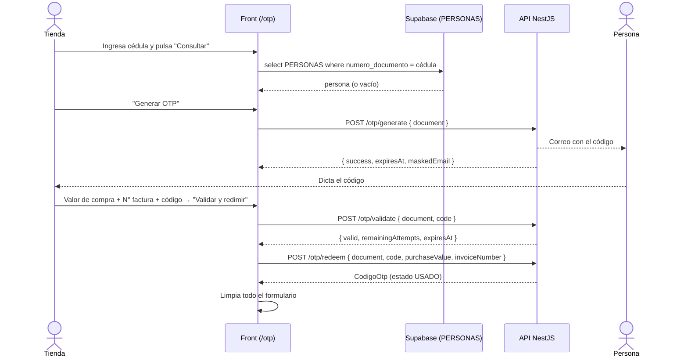

# 03 · Generación y redención de OTP (tiendas)

Pantalla principal del rol `TIENDA`. En un solo flujo la tienda identifica a la persona, le genera un código OTP que llega a su correo y lo redime registrando el valor de la compra y el número de factura.

- **Ruta:** `/otp`
- **Acceso:** requiere rol `TIENDA`

## Archivos

| Archivo | Responsabilidad |
| --- | --- |
| [components/Otp/Otp.tsx](../src/components/Otp/Otp.tsx) | Contenedor: estado del flujo y orquestación de los tres pasos |
| [components/Otp/CedulaForm.tsx](../src/components/Otp/CedulaForm.tsx) | Formulario de búsqueda por cédula (solo dígitos, máx. 15) |
| [components/Otp/PersonResult.tsx](../src/components/Otp/PersonResult.tsx) | Tarjeta con los datos de la persona encontrada (también se reutiliza en Historial) |
| [components/Otp/OtpCodeBlock.tsx](../src/components/Otp/OtpCodeBlock.tsx) | Botón Generar/Regenerar OTP y aviso "Código enviado a … · vence HH:MM" |
| [components/Otp/OtpValidateBlock.tsx](../src/components/Otp/OtpValidateBlock.tsx) | Formulario de valor de compra, número de factura y código recibido |
| [components/Otp/OtpIcons.tsx](../src/components/Otp/OtpIcons.tsx) | Iconos SVG compartidos (`IconId`, `IconUser`, `IconMail`, `IconPhone`, `IconCheck`, `IconRefresh`) |
| [Funcionalidades/code/hooks/useGenerarOtp.ts](../src/Funcionalidades/code/hooks/useGenerarOtp.ts) | Hook para `POST /otp/generate` |
| [Funcionalidades/code/hooks/useValidarOtp.ts](../src/Funcionalidades/code/hooks/useValidarOtp.ts) | Hook para `POST /otp/validate` |
| [Funcionalidades/code/hooks/useRedimirOtp.ts](../src/Funcionalidades/code/hooks/useRedimirOtp.ts) | Hook para `POST /otp/redeem` |
| [Funcionalidades/code/services/otp.service.ts](../src/Funcionalidades/code/services/otp.service.ts) | Funciones de llamada a la API de OTP |
| [Funcionalidades/code/utils/otp.utils.ts](../src/Funcionalidades/code/utils/otp.utils.ts) | `OTP_LENGTH = 6` y formateadores de fecha y moneda |

## Flujo

### 1. Consultar persona

- La búsqueda se hace **directamente contra Supabase** (`PERSONAS`, columnas `id, tipo_documento, numero_documento, nombres, apellidos, correo, telefono, estado`) con `.maybeSingle()`. Depende de que la política RLS de `PERSONAS` permita la lectura al rol de la tienda.
- Cada nueva consulta reinicia el estado: persona, OTP generado, código ingresado, validación y valor de compra.
- Si no hay coincidencia se muestra *"No se encontró ninguna persona con esa cédula"*.

### 2. Generar OTP

- El botón solo se habilita cuando hay una persona encontrada.
- Se envía `numero_documento` como `document`.
- La respuesta incluye el correo enmascarado (`maskedEmail`) y la fecha de expiración (`expiresAt`), que se muestran en `OtpCodeBlock`.
- Pulsar de nuevo ("Regenerar OTP") solicita un código nuevo y limpia lo ingresado. La invalidación del código anterior la resuelve la API.

### 3. Validar y redimir

`OtpValidateBlock` solo se muestra cuando ya se generó un OTP.

| Campo | Reglas |
| --- | --- |
| Valor de la compra | Solo dígitos; se muestra con separador de miles `es-CO`; obligatorio |
| Número de la factura | Solo dígitos, máximo 6 caracteres; obligatorio |
| Código recibido | Solo dígitos, exactamente `OTP_LENGTH` (6) |

El botón se habilita cuando el código tiene 6 dígitos y hay valor de compra. Al enviar:

1. Se valida el código (`/otp/validate`). Si falla: *"El código ingresado es inválido, ya fue usado o está vencido."*
2. Si es válido, se redime en la misma acción (`/otp/redeem`) enviando `purchaseValue` y `invoiceNumber` como números.
3. Si la redención es correcta se limpia todo (incluida la cédula) y se muestra *"Código redimido correctamente."*

## Contratos con la API

| Endpoint | Body | Respuesta |
| --- | --- | --- |
| `POST /otp/generate` | `{ document: string }` | `generateOtpResponse` → `{ success, expiresAt, maskedEmail }` |
| `POST /otp/validate` | `{ document: string, code: string }` | `validateOtpResponse` → `{ valid: true, remainingAttempts, expiresAt }` |
| `POST /otp/redeem` | `{ document, code, purchaseValue: number, invoiceNumber: number }` | `CodigoOtp` |

La tienda que genera y la que redime no se envían desde el front: la API las deduce del usuario autenticado (token `Bearer` de Supabase). Tipos en [models/code.ts](../src/models/code.ts).

## Manejo de errores

Los hooks capturan la excepción, guardan el mensaje en `error` y devuelven `null`. `Otp.tsx` muestra toasts con mensajes genéricos; el mensaje específico de la API queda disponible en `error` de cada hook pero hoy no se muestra en pantalla.
