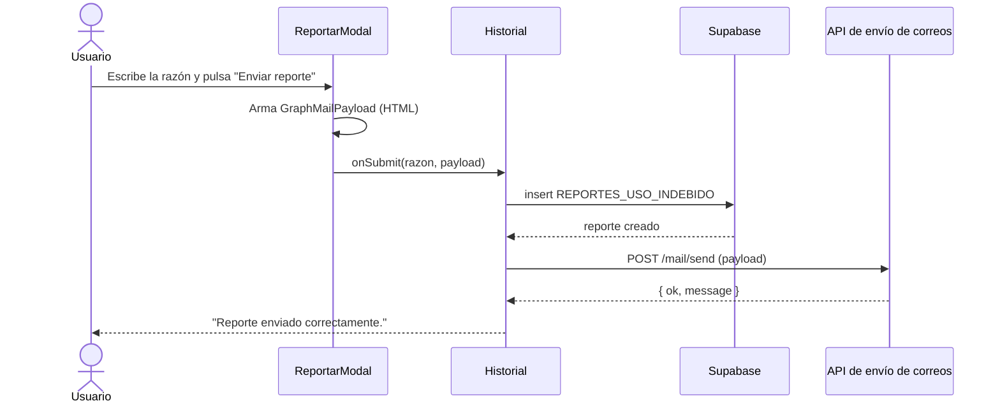

# 04 · Historial de códigos y reporte de uso indebido

Pantalla para que el beneficiario (empleado, socio o control interno) consulte los códigos OTP generados a su nombre y reporte cualquiera que no reconozca.

- **Ruta:** `/historial-codigos`
- **Acceso:** cualquier sesión **sin** rol `TIENDA`
- Es la pantalla por defecto después del login para los roles distintos de `TIENDA`.

## Archivos

| Archivo | Responsabilidad |
| --- | --- |
| [components/Historial/Historial.tsx](../src/components/Historial/Historial.tsx) | Contenedor: carga automática del historial y registro del reporte |
| [components/Historial/HistorialList.tsx](../src/components/Historial/HistorialList.tsx) | Lista de códigos con estado, valor, fechas y botón "Reportar" |
| [components/Historial/ReportarModal.tsx](../src/components/Historial/ReportarModal.tsx) | Modal con el resumen del código, campo "Razón del reporte" y armado del correo HTML |
| [Funcionalidades/code/hooks/useHistorialOtp.ts](../src/Funcionalidades/code/hooks/useHistorialOtp.ts) | Hook para `POST /otp/history` |
| [Funcionalidades/reportes/hooks/useCrearReporte.ts](../src/Funcionalidades/reportes/hooks/useCrearReporte.ts) | Hook que registra el reporte y envía la notificación por correo |
| [Funcionalidades/reportes/services/reportes.service.ts](../src/Funcionalidades/reportes/services/reportes.service.ts) | Insert en la tabla `REPORTES_USO_INDEBIDO` |
| [models/reporte.ts](../src/models/reporte.ts), [models/mail.ts](../src/models/mail.ts) | Tipos del reporte y del payload de correo (formato Microsoft Graph) |

## Carga del historial

- Se dispara automáticamente cuando `AuthContext` terminó de cargar y existe `person`.
- Usa la cédula (`person.numero_documento`) y el correo (`person.correo`) del usuario autenticado: `POST /otp/history { document, email }`.
- Si el perfil no tiene cédula o correo, muestra una sola vez el toast *"Tu perfil no tiene cédula o correo configurado…"* y no consulta.
- Se carga una sola vez por montaje (`hasLoadedHistorial`).

Cada elemento (`HistorialCodigo`) muestra:

| Campo | Fuente | Formato |
| --- | --- | --- |
| Código | `code` | `"Sin codigo"` si es `null` |
| Estado | `status` (`REDIMIDO` \| `EXPIRADO`) | Chip con color |
| Valor | `purchaseValue` | Moneda COP, o `"No canjeado"` si es 0 |
| Generado / Vence / Redimido | `generatedAt`, `expiresAt`, `redeemedAt` | `dd mmm aaaa` (`es-CO`), `—` si es nulo |

## Reportar un código

### 1. Registro en base de datos

`crearReporteRequest` inserta directamente en Supabase, en la tabla `REPORTES_USO_INDEBIDO`:

| Columna | Valor |
| --- | --- |
| `codigo_otp_id` | `Number(codigo.id)` |
| `persona_id` | `person.id` del usuario autenticado |
| `tipo_reporte` | `"Uso indebido"` (fijo) |
| `descripcion` | Razón escrita por el usuario (obligatoria) |
| `fecha_reporte` | `new Date()` del cliente |

### 2. Notificación por correo

Solo si el insert fue exitoso, `notifyReport` envía el payload a la API de correos corporativa (`https://api-envio-correos-…azurewebsites.net/mail/send`), que a su vez usa Microsoft Graph.

Contenido del correo (armado en `ReportarModal`):

- **Remitente:** `alert@estudiodemoda.com.co`
- **Destinatario:** fijo en el código (`toRecipients`), sin copias
- **Asunto:** "Reporte de uso indebido"
- **Cuerpo HTML:** tienda donde se generó y donde se redimió, código OTP, nombre y cédula del usuario, valor y un aviso de "Reporte registrado".
- `saveToSentItems: true`

Si la API de correos responde `ok: false`, se muestra su mensaje en un toast y el modal permanece abierto (el reporte ya quedó registrado en base de datos).

> La razón escrita por el usuario se guarda en la base de datos pero **no** se incluye en el cuerpo del correo.

## Estados de carga y vacíos

| Situación | Mensaje |
| --- | --- |
| Cargando sesión | "Cargando información del usuario..." |
| Cargando historial | "Cargando historial..." |
| Sesión sin persona asociada | "No se encontró información de la persona asociada al usuario autenticado." |
| Historial vacío | "Esta persona no tiene códigos generados." |
