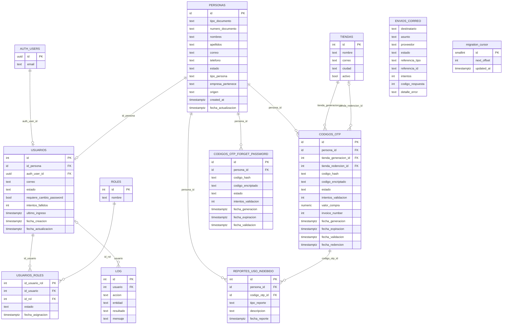
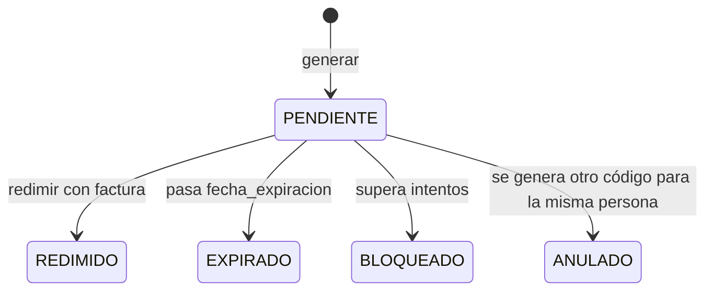

# Modelo de datos de la base (Supabase / PostgreSQL)

Una sola base PostgreSQL en Supabase atiende a tres clientes:

- **Front** (este repositorio), con la clave pública (`anon`) y la sesión del usuario, así que pasa por RLS.
- **API NestJS** (`CI-Back-Compras-y-descuentos`), con la clave de servicio.
- **Edge Functions** ([supabase/functions](../../supabase/functions)), con la clave de servicio.

> **Fuente de verdad.** Las migraciones de [supabase/migrations](../../supabase/migrations) están desactualizadas (ver [README.md](README.md#migraciones)). Este documento se reconstruyó a partir de las consultas del front, del backend y de las Edge Functions. Los tipos SQL exactos, índices, *defaults* y políticas RLS no se pueden deducir del código: para verlos, saca un volcado del esquema real con `supabase db dump --schema public -f schema.sql` (requiere `supabase link`).

## Convenciones

- Las tablas de negocio usan nombres en MAYÚSCULAS y hay que citarlas siempre con comillas dobles: `select * from public."PERSONAS"`. Sin comillas, Postgres busca `personas` y falla. Las tablas de soporte (`migration_cursor`, `migration_logs`) van en minúsculas.
- Columnas en `snake_case` y en español, salvo `invoice_number` en `CODIGOS_OTP`.
- Los estados se guardan como texto en mayúsculas (`ACTIVO`, `INACTIVO`, `PENDIENTE`…). En lo que se puede ver desde el código, no hay tipos `enum` de Postgres.
- Las fechas se escriben desde el código como ISO 8601 (`new Date().toISOString()`).

## Diagrama entidad-relación

Los tipos del diagrama son aproximados. `id` en las PK de `PERSONAS`, `CODIGOS_OTP` y `CODIGOS_OTP_FORGET_PASSWORD` indica que el código los trata como `string` (puede ser `uuid` o un entero serializado). Las relaciones con nombre de *constraint* confirmado son `usuarios_id_persona_fkey` y `usuarios_roles_id_rol_fkey`, porque el front las usa en los *embeds* de PostgREST. Las demás FK se deducen por nombre de columna.

## Quién usa cada tabla

| Tabla | Front | API NestJS | Edge Functions |
| --- | --- | --- | --- |
| `PERSONAS` | Lee (búsqueda por cédula en `/otp`, exportación) | Lee | `bulk-create-users`, `sincronizacion-you`: crean y actualizan |
| `USUARIOS` | Lee el perfil; actualiza `requiere_cambio_password` | Lee | `bulk-create-users`, `sincronizacion-you`: crean y actualizan |
| `ROLES` | Lee (vía *embed*) | Lee (vía *embed*) | `bulk-create-users`: lee |
| `USUARIOS_ROLES` | Lee | Lee | `bulk-create-users`, `sincronizacion-you`: crean y actualizan |
| `TIENDAS` | — | Lee | — |
| `CODIGOS_OTP` | — | Lee y escribe | — |
| `CODIGOS_OTP_FORGET_PASSWORD` | — | Lee y escribe | — |
| `REPORTES_USO_INDEBIDO` | Inserta | Lee | — |
| `ENVIOS_CORREO` | — | Inserta | — |
| `LOG` | — | Inserta; `/api/health` lee 1 fila | `sincronizacion-you` inserta; `keep-db-awake` lee |
| `migration_cursor` | — | — | `sincronizacion-you`, `migrate-sharepoint-users`: leen y escriben |
| `auth.users` | Supabase Auth (login, cambio de contraseña) | `auth.admin` (token de recuperación) | `auth.admin` (crear, actualizar, deshabilitar) |

Como el front accede **directamente** a `PERSONAS`, `USUARIOS`, `USUARIOS_ROLES`, `ROLES` y `REPORTES_USO_INDEBIDO` con la clave `anon`, esas tablas necesitan políticas RLS para el rol `authenticated`. El resto solo se toca con la clave de servicio, que ignora RLS.

## Tablas

### Identidad y acceso

#### `PERSONAS`

Datos personales de cualquier persona: empleado, socio comercial, usuario de tienda o administrador. Es la entidad a la que se le emiten los códigos OTP.

| Columna | Descripción |
| --- | --- |
| `id` | PK autogenerada |
| `tipo_documento` | Ej. `CC`. La sincronización siempre escribe `CC` |
| `numero_documento` | Cédula. Clave natural: se busca por ella en `/otp`, en la API y en la sincronización |
| `nombres`, `apellidos` | |
| `correo` | Correo personal; ahí llega el OTP. La recuperación de contraseña busca la persona activa por este correo (sin distinguir mayúsculas) |
| `telefono` | |
| `estado` | `ACTIVO` / `INACTIVO` |
| `tipo_persona` | `bulk-create-users` escribe `SOCIO COMERCIAL` |
| `empresa_pertenece` | Empresa del socio comercial (carga masiva) |
| `origen` | Lo lee la API; en `sincronizacion-you` el origen (`SHAREPOINT_YOU`) se guarda en los metadatos de Auth, no en esta columna |
| `created_at`, `fecha_actualizacion` | |

#### `USUARIOS`

Cuenta de acceso a la aplicación. Une una persona con su usuario de Supabase Auth (relación 1 a 1 en la práctica).

| Columna | Descripción |
| --- | --- |
| `id` | PK numérica |
| `id_persona` | FK → `PERSONAS.id` (`usuarios_id_persona_fkey`) |
| `auth_user_id` | `auth.users.id`. Así se encuentra el perfil a partir de la sesión |
| `correo` | Correo de login |
| `estado` | `ACTIVO` / `INACTIVO` / `BLOQUEADO` |
| `requiere_cambio_password` | `true` al crear la cuenta; obliga a cambiar la contraseña en el primer ingreso. El front lo pone en `false` tras el cambio |
| `intentos_fallidos`, `ultimo_ingreso` | |
| `fecha_creacion`, `fecha_actualizacion` | |

#### `ROLES`

Catálogo de roles. Valores que usa el código: `TIENDA`, `CONTROL_INTERNO`, `EMPLEADO`, `SOCIO`.

| Columna | Descripción |
| --- | --- |
| `id` | PK numérica |
| `nombre` | Nombre del rol; las funciones lo buscan por este valor |

#### `USUARIOS_ROLES`

Asignación N a N entre usuarios y roles. Solo cuentan las filas con `estado = 'ACTIVO'`; los roles se desactivan en vez de borrarse.

| Columna | Descripción |
| --- | --- |
| `id_usuario_rol` | PK |
| `id_usuario` | FK → `USUARIOS.id` |
| `id_rol` | FK → `ROLES.id` (`usuarios_roles_id_rol_fkey`) |
| `estado` | `ACTIVO` / `INACTIVO` |
| `fecha_asignacion` | |

Reglas de asignación:

- `bulk-create-users` solo asigna su rol fijo si el usuario no tiene **ningún** rol activo; no pisa `TIENDA`, `EMPLEADO` ni `CONTROL_INTERNO`.
- `sincronizacion-you` asigna o reactiva el rol configurado (`roleId`), normalmente `EMPLEADO`.

### Operación de descuentos

#### `TIENDAS`

Tiendas que generan y redimen códigos. Un usuario con rol `TIENDA` se asocia a su tienda por correo (`TIENDAS.correo` = correo del usuario, comparado sin distinguir mayúsculas).

| Columna | Descripción |
| --- | --- |
| `id` | PK numérica |
| `nombre` | |
| `correo` | Correo de la tienda; enlace con el usuario `TIENDA` |
| `ciudad` | |
| `activo` | Booleano |

#### `CODIGOS_OTP`

Códigos de descuento de un solo uso. Se generan para una persona desde una tienda y se redimen contra una factura.

| Columna | Descripción |
| --- | --- |
| `id` | PK |
| `persona_id` | FK → `PERSONAS.id` (beneficiario) |
| `tienda_generacion_id` | FK → `TIENDAS.id` |
| `tienda_redencion_id` | FK → `TIENDAS.id`; `null` hasta la redención |
| `codigo_hash` | Hash del código; la validación compara contra este valor |
| `codigo_encriptado` | Código cifrado (reversible) |
| `estado` | Ver estados abajo |
| `intentos_validacion` | Intentos fallidos de validación |
| `valor_compra` | Valor de la compra, se escribe al redimir |
| `invoice_number` | Número de factura, se escribe al redimir |
| `fecha_generacion`, `fecha_expiracion` | |
| `fecha_validacion`, `fecha_redencion` | |

Estados:

Todas las transiciones se hacen con `... where estado = 'PENDIENTE'`, para que dos peticiones simultáneas no rediman el mismo código dos veces. La API además limita cuántos códigos puede generar una persona por día (cuenta por `fecha_generacion`).

#### `CODIGOS_OTP_FORGET_PASSWORD`

Códigos para recuperar la contraseña. Misma mecánica que `CODIGOS_OTP`, sin tiendas ni factura.

| Columna | Descripción |
| --- | --- |
| `id` | PK |
| `persona_id` | FK → `PERSONAS.id` |
| `codigo_hash`, `codigo_encriptado` | |
| `estado` | `PENDIENTE`, `VERIFICADO`, `ANULADO`, `EXPIRADO`, `BLOQUEADO` |
| `intentos_validacion` | Se incrementa con control optimista (`where intentos_validacion = <leído>`) |
| `fecha_generacion`, `fecha_expiracion`, `fecha_validacion` | |

Al verificarse, la API genera un token de recuperación de Supabase Auth y el front lo canjea con `verifyOtp({ type: 'recovery' })` para cambiar la contraseña.

#### `REPORTES_USO_INDEBIDO`

Reportes de un beneficiario sobre un código que no reconoce. El front los inserta directamente.

| Columna | Descripción |
| --- | --- |
| `id` | PK numérica |
| `persona_id` | FK → `PERSONAS.id` (quien reporta) |
| `codigo_otp_id` | FK → `CODIGOS_OTP.id` |
| `tipo_reporte` | Hoy siempre `Uso indebido` |
| `descripcion` | Texto escrito por el usuario |
| `fecha_reporte` | |

### Auditoría y soporte

#### `LOG`

Bitácora compartida por la API y la sincronización.

| Columna | Descripción |
| --- | --- |
| `id` | PK |
| `usuario` | `USUARIOS.id` afectado, o `null` |
| `accion` | Ej. `SINCRONIZACION_INICIADA`, `USUARIO_CREADO`, `ROL_ASIGNADO`, `ERROR_AUTH`, o las acciones de OTP de la API |
| `entidad` | Ej. `SINCRONIZACION_YOU`, `SHAREPOINT`, `AUTH_USERS`, `PERSONAS`, `USUARIOS`, `USUARIOS_ROLES` |
| `resultado` | `EXITOSO`, `ERROR`, `OMITIDO`, `SIN_CAMBIOS`, `SIMULADO` |
| `mensaje` | Texto o JSON serializado (la API no lo llena) |

Una falla al escribir en `LOG` desde la API no interrumpe la operación principal.

#### `ENVIOS_CORREO`

Registro de cada correo que envía la API (por ejemplo, el OTP).

| Columna | Descripción |
| --- | --- |
| `destinatario`, `asunto`, `proveedor` | |
| `estado` | `ENVIADO` / `FALLIDO` |
| `referencia_tipo`, `referencia_id` | Entidad que originó el correo (ej. un código OTP) |
| `intentos` | Por defecto 1 |
| `codigo_respuesta` | Código HTTP del proveedor |
| `detalle_error` | Truncado a 1000 caracteres |

#### `migration_cursor`

Una sola fila (`id = 1`, con `check (id = 1)`). `next_offset` guarda por dónde va el recorrido por lotes de la lista de SharePoint; `updated_at`, cuándo se movió. La comparten `sincronizacion-you` y `migrate-sharepoint-users`.

#### `migration_logs`

Creada por la migración inicial para `migrate-sharepoint-users` (`run_id`, `email`, `status`, `message`, `created_at`). La sincronización actual escribe en `LOG` en su lugar.

#### `REPORTES` (obsoleta)

La crea la migración `20260724000000_create_reportes_table.sql`, pero ningún código la usa. Los reportes van a `REPORTES_USO_INDEBIDO`.

## Flujos principales

| Flujo | Tablas, en orden |
| --- | --- |
| Login | `auth.users` → `USUARIOS` (por `auth_user_id`) → `USUARIOS_ROLES` + `ROLES` |
| Alta por carga masiva | `auth.users` → `PERSONAS` → `USUARIOS` → `USUARIOS_ROLES` |
| Sincronización YOU | `migration_cursor` → `PERSONAS` (por `numero_documento`) → `auth.users` → `USUARIOS` → `USUARIOS_ROLES` → `LOG` |
| Generar OTP (tienda) | `TIENDAS` (por correo del usuario) → `PERSONAS` → `CODIGOS_OTP` (anula pendientes, inserta) → `ENVIOS_CORREO` → `LOG` |
| Redimir OTP | `CODIGOS_OTP` (valida hash, actualiza a `REDIMIDO`) → `TIENDAS` → `LOG` |
| Reportar uso indebido | `REPORTES_USO_INDEBIDO` |
| Recuperar contraseña | `PERSONAS` (por correo) → `CODIGOS_OTP_FORGET_PASSWORD` → `USUARIOS` → `auth.users` |

## Inconsistencias conocidas

- **Migraciones vs. base real.** `PERSONAS` y `USUARIOS` en las migraciones tienen otro esquema (PK `user_id` uuid, columnas en inglés). No hay migraciones para `ROLES`, `USUARIOS_ROLES`, `LOG`, `TIENDAS`, `CODIGOS_OTP`, `CODIGOS_OTP_FORGET_PASSWORD`, `REPORTES_USO_INDEBIDO` ni `ENVIOS_CORREO`. Lo recomendable es generar una migración base desde el volcado del esquema real y reemplazar las actuales.
- **Tipo de `codigo_otp_id`.** El front lo tipa como `number` ([reporte.ts](../../src/models/reporte.ts)) y la API trata `CODIGOS_OTP.id` como `string`. Conviene confirmar el tipo real de la columna.
- **`UsersRepository` del backend.** Selecciona `correo` e `id_persona`, pero lee `email` y `persona_id` de la fila, así que esos dos campos quedan `undefined` en el usuario que resuelve la API.
- **`TIENDAS.codigo`.** La API lo mapea, pero no lo incluye en el `select`; probablemente la columna no existe.
