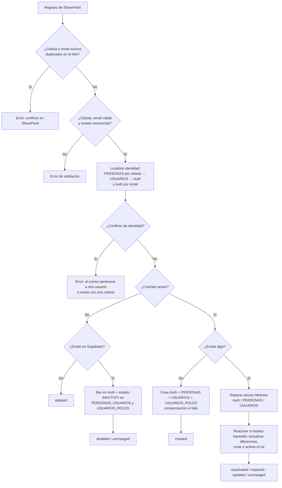

# Edge Function: `sincronizacion-you`

Sincroniza los empleados de la lista de SharePoint "YOU" (vía Microsoft Graph) con Supabase Auth y las tablas `PERSONAS`, `USUARIOS` y `USUARIOS_ROLES`, registrando cada acción en `LOG`. Es la versión vigente y reemplaza a [migrate-sharepoint-users](migrate-sharepoint-users.md).

- **Código:** [supabase/functions/sincronizacion-you/](../../supabase/functions/sincronizacion-you)
- **La invoca:** cron (`pg_cron` + `pg_net` o Cron del dashboard) o una llamada manual. El front no la usa.
- **Método:** `POST` (y `OPTIONS`)
- **`verify_jwt`:** `false` (en [config.toml](../../supabase/config.toml))

## Estructura del código

| Archivo | Responsabilidad |
| --- | --- |
| `index.ts` | Entrada HTTP: autorización, parseo del body, construcción de servicios, manejo de errores |
| `config.ts` | Lectura y validación de variables de entorno (`loadConfig`) |
| `validators.ts` | Validación del body (`parseRequestBody`) y de la cédula como contraseña inicial (`validatePasswordAgainstPolicy`) |
| `graph.service.ts` | Token OAuth (client credentials) y lectura paginada de la lista; valida que cada `@odata.nextLink` sea de `graph.microsoft.com` |
| `auth.service.ts` | Operaciones `auth.admin` (listar, crear, actualizar, deshabilitar, reactivar y eliminar usuarios) con caché por correo e id |
| `database.service.ts` | CRUD de `PERSONAS`, `USUARIOS`, `USUARIOS_ROLES`, `LOG` y `migration_cursor` |
| `log.service.ts` | Escritura en `LOG` y en el cursor sin interrumpir la sincronización si fallan |
| `sync.service.ts` | Lógica de negocio: detección de conflictos, alta, actualización, baja, reactivación, reparación y compensación |
| `types.ts` | Tipos y jerarquía de errores (`AppError` y subclases con código HTTP) |
| `utils.ts` | Normalización de textos, correos y estados; CORS; respuestas JSON |

## Autorización

`Authorization: Bearer <MIGRATION_SECRET>` **o** `x-migration-secret: <MIGRATION_SECRET>`. Si no coincide → `401 AUTHORIZATION_ERROR`.

## Request

Todos los campos son opcionales; un body vacío equivale a `{ "dryRun": false }`.

| Campo | Tipo | Descripción |
| --- | --- | --- |
| `dryRun` | `boolean` | Calcula las acciones sin escribir en Auth ni en tablas (sí escribe en `LOG` con resultado `SIMULADO`) |
| `limit` | entero > 0 | Tamaño del lote (por defecto 200) |
| `offset` | entero ≥ 0 | Posición inicial en la lista. Si se omite, se lee de `migration_cursor` |
| `email` | `string` | Procesar solo el registro con ese correo (dentro del lote) |
| `cedula` | `string` | Procesar solo el registro con esa cédula (dentro del lote) |
| `sharePointItemId` | `string` | Procesar un único elemento de la lista por su id |
| `roleId` | entero > 0 | Rol a asignar; por defecto `DEFAULT_ROLE_ID` |

> `email` y `cedula` filtran **dentro del lote leído** (`offset`/`limit`), no en toda la lista. Para un registro concreto, usa `sharePointItemId`.

## Campos esperados en SharePoint

| Campo interno | Uso |
| --- | --- |
| `cedula` | `PERSONAS.numero_documento` y contraseña inicial |
| `nombres` | `PERSONAS.nombres` |
| `primer_apellido`, `segundo_apellido` | Se unen en `PERSONAS.apellidos` |
| `telefono` | `PERSONAS.telefono` |
| `email` | Correo de Auth, `PERSONAS.correo` y `USUARIOS.correo` (en minúsculas) |
| `estado_contrato` | Activo: `activo`, `active`, `habilitado`, `true`, `1`, `si`. Inactivo: `inactivo`, `inactive`, `deshabilitado`, `false`, `0`, `no`, `terminado`, `retirado`. Sin tildes ni distinción de mayúsculas; cualquier otro valor es un error de validación |

## Algoritmo por registro



Detalles:

- **Alta (`created`):** antes de crear, se verifica que la cédula cumpla la política de contraseña (`AUTH_MINIMUM_PASSWORD_LENGTH`, `AUTH_PASSWORD_REQUIREMENTS`). Crea el usuario de Auth con `user_metadata` (`nombres`, `apellidos`, `numero_documento`, `origen: "SHAREPOINT_YOU"`, `estado`, `requiere_cambio_password: true`), `PERSONAS` con `tipo_documento = "CC"`, `USUARIOS` con `requiere_cambio_password = true` y la asignación de rol. Si un paso falla, la **compensación** borra lo creado en orden inverso (`USUARIOS` → `PERSONAS` → Auth).
- **Baja (`disabled`):** banea el usuario de Auth por `876000h` (~100 años), marca `deshabilitado_por: "SINCRONIZACION_YOU"` en los metadatos y pone `INACTIVO` en `PERSONAS`, `USUARIOS` y la asignación del rol indicado. Un registro inactivo que no existe en Supabase se omite (`skipped`).
- **Actualización:** compara `nombres`, `apellidos`, `correo`, `telefono` y `estado` en `PERSONAS`; `correo`, `estado` y `requiere_cambio_password` en `USUARIOS`; correo y metadatos en Auth. Solo escribe lo que cambió.
- **Reparación (`repaired`):** si falta alguna pieza (usuario de Auth, `PERSONAS` o `USUARIOS`) pero el resto existe, la crea y la enlaza.

> **Atención:** en la actualización, si `USUARIOS.requiere_cambio_password` no es `true`, la función lo vuelve a poner en `true`. Un empleado activo que ya cambió su contraseña tendrá que cambiarla otra vez después de cada sincronización.

## Cursor

- Sin `offset` ni `sharePointItemId`, el lote empieza en `migration_cursor.next_offset`.
- Al terminar una ejecución real (no `dryRun`) sin `offset` manual, se guarda el `nextOffset`; al llegar al final de la lista se guarda `0` y el siguiente ciclo vuelve a empezar.
- Un `dryRun` o una ejecución con `offset` explícito no modifican el cursor.

## Respuesta

```json
{
  "success": true,
  "dryRun": false,
  "startedAt": "2026-07-24T13:10:35.000Z",
  "finishedAt": "2026-07-24T13:10:42.000Z",
  "durationMs": 7000,
  "filters": { "email": null, "cedula": null, "sharePointItemId": null, "limit": 200, "offset": 0, "roleId": 2 },
  "cursor": { "source": "stored", "offsetUsed": 0, "nextOffset": 200, "hasMore": true, "batchSize": 200 },
  "summary": {
    "sharePointRecords": null, "processed": 200, "created": 10, "updated": 15, "disabled": 3,
    "reactivated": 2, "repaired": 1, "unchanged": 160, "skipped": 5, "errors": 4
  },
  "partialErrors": true,
  "errors": [{ "sourceId": "25", "numeroDocumento": "123", "email": "x@y.com", "message": "…" }]
}
```

- `sharePointRecords` es `null` cuando el lote se cortó antes del final de la lista (no se conoce el total).
- `errors` devuelve como máximo 200 elementos.

Errores generales (`success: false`, con `code`):

| HTTP | `code` | Causa |
| --- | --- | --- |
| 400 | `REQUEST_VALIDATION_ERROR` | Body inválido |
| 401 | `AUTHORIZATION_ERROR` | Secreto incorrecto |
| 405 | — | Método distinto de `POST` |
| 500 | `CONFIG_ERROR` | Falta una variable de entorno (el mensaje es su nombre) |
| 502 | `MICROSOFT_OAUTH_ERROR` / `MICROSOFT_GRAPH_ERROR` | Fallo con Microsoft |

## Registro en `LOG`

Se escribe una fila al inicio (`SINCRONIZACION_INICIADA`), una por cada registro procesado (`USUARIO_CREADO`, `USUARIO_ACTUALIZADO`, `USUARIO_DESHABILITADO`, `USUARIO_REACTIVADO`, `ROL_ASIGNADO`, `REGISTRO_REPARADO`, `REGISTRO_OMITIDO`, `ERROR_*`, `COMPENSACION_EJECUTADA`) y una al final (`SINCRONIZACION_FINALIZADA`).

## Variables de entorno

| Variable | Obligatoria | Por defecto |
| --- | --- | --- |
| `MS_TENANT_ID`, `MS_CLIENT_ID`, `MS_CLIENT_SECRET` | Sí | — |
| `MS_SITE_ID`, `MS_LIST_ID` | Sí | — |
| `MIGRATION_SECRET` | Sí | — |
| `DEFAULT_ROLE_ID` | Sí | — |
| `SUPABASE_URL` | Sí (automática) | — |
| `SUPABASE_SERVICE_ROLE_KEY` o `SUPABASE_SECRET_KEYS` | Sí (automática) | — |
| `GRAPH_TIMEOUT_MS` | No | `15000` |
| `AUTH_MINIMUM_PASSWORD_LENGTH` | No | `6` |
| `AUTH_PASSWORD_REQUIREMENTS` | No | `""` (`letters_digits`, `lower_upper_letters_digits`, `lower_upper_letters_digits_symbols`) |

La App Registration de Entra ID necesita el permiso de aplicación `Sites.Read.All` (o `Sites.Selected` sobre el sitio) con consentimiento de administrador.

## Ejemplos

```bash
# Simulación de 10 registros
curl -X POST 'https://<PROJECT_REF>.supabase.co/functions/v1/sincronizacion-you' \
  -H 'Content-Type: application/json' \
  -H 'Authorization: Bearer <MIGRATION_SECRET>' \
  -d '{"dryRun": true, "limit": 10}'

# Un solo elemento de SharePoint
curl -X POST 'https://<PROJECT_REF>.supabase.co/functions/v1/sincronizacion-you' \
  -H 'Content-Type: application/json' \
  -H 'x-migration-secret: <MIGRATION_SECRET>' \
  -d '{"sharePointItemId": "25"}'
```

Más ejemplos y la programación con `pg_cron` están en el [README de la función](../../supabase/functions/sincronizacion-you/README.md).
